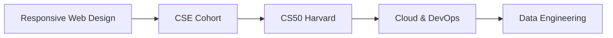

# 🚀 Hi, I'm Allan James

<div align="center">
  
  [](https://git.io/typing-svg)
  
</div>

<p align="center">
  
</p>

---

## 🎯 **Where Software Meets Data**

Welcome to my corner of GitHub! I'm passionate about crafting **scalable applications**, architecting **robust backend systems**, and transforming raw data into **actionable insights**. With a foundation in physics, I approach software development with analytical rigor and a problem-solving mindset.

---

## 👨‍💻 **About Me**

```python
class SoftwareEngineer:
    def __init__(self):
        self.name = "Allan James"
        self.role = "Software Engineer"
        self.location = "Kyambogo University Alum"
        self.interests = [
            "Backend Systems",
            "Data Engineering", 
            "Cloud Architecture",
            "Physics & Technology"
        ]
        self.current_focus = "Cloud Deployment & System Design"
        self.collaboration = "Open to impactful projects"
    
    def say_hi(self):
        print("Let's build something amazing together! 🚀")
```

- 🎓 **Education:** BSc in Physics – Kyambogo University
- 🔭 **Currently Exploring:** Advanced system design, distributed systems, and cloud-native development
- 💡 **Core Philosophy:** Clean code, scalable architecture, and data-driven decisions
- 🌱 **Learning Path:** AWS → Docker → Kubernetes → System Design
- 🤝 **Looking For:** Projects that challenge the status quo and make a difference

---

## 🛠️ **Technology Stack**

<div align="center">

### 💻 **Languages**


### 🚀 **Frameworks & Libraries**


### 🗄️ **Databases**


### ☁️ **DevOps & Cloud**


</div>

---

## 🌟 **Featured Projects**

### 🏢 **Salon Management System**
> *A comprehensive Django solution for modern salon businesses*

```yaml
features:
  - Customer booking & management
  - Service & pricing configuration
  - Staff scheduling & management
  - Customer history tracking
  - Business analytics dashboard
tech_stack: Django, PostgreSQL, Bootstrap
status: 🟢 Production Ready
```

[](https://github.com/allanjames-prog)

---

### ⚡ **Student Performance API** *(In Progress)*
> *Building a scalable backend with modern cloud architecture*

```yaml
features:
  - RESTful API design
  - Docker containerization
  - AWS deployment
  - Database integration
  - Performance analytics
tech_stack: FastAPI, PostgreSQL, Docker, AWS
status: 🟡 Active Development
```

---

### 📊 **ETL Data Pipeline**
> *End-to-end data engineering project*

```yaml
features:
  - Bronze/Silver/Gold data layers
  - Data cleaning & transformation
  - SQL analytics
  - Quality assurance checks
  - Automated workflows
tech_stack: Python, SQL, DuckDB, Pandas
status: 🟢 Complete
```

---

### 🌐 **Portfolio Website**
> *Showcasing my professional journey*

[](https://web-production-ec847.up.railway.app/)

---

### 🔥 **Calorie Counter App**
> *Track your nutrition goals effectively*

```yaml
features:
  - Calorie tracking
  - Food database
  - Daily progress monitoring
  - Interactive UI
tech_stack: JavaScript, HTML, CSS
status: 🟢 Complete
```

[](https://github.com/allanjames-prog/calorie-counter)

---

## 📜 **Certifications & Learning**



- 🎯 Responsive Web Design – freeCodeCamp
- 📚 CSE Cohort – Refactory
- 🏫 CS50 Computer Science – Harvard (Coursework)
- ☁️ AWS, Docker & Cloud Architecture (Self-paced)
- 📊 Data Engineering Fundamentals

---

## 📫 **Let's Connect!**

<div align="center">

[](mailto:khiisa31@gmail.com)
[](https://www.linkedin.com/in/allan-james-09963a249/)
[](https://github.com/allanjames-prog)

</div>

---

## 🧩 **Beyond the Code**

<div align="center">
  
| 🎯 Passion | 🎮 Hobby | 🌍 Interest |
|------------|----------|-------------|
| Physics & Science | Puzzle Enthusiast | Innovation |
| Technology | Soccer Player | Problem-Solving |
| Data Science | Reading | Global Impact |

</div>

---

## 📊 **GitHub Analytics**

<div align="center">
  
  
  
  
</div>

<div align="center">
  
  
  
</div>

---

<div align="center">
  
  *“The best way to predict the future is to build it.”*
  
  ### Thanks for visiting! 🚀
  
  
  
</div>

---

